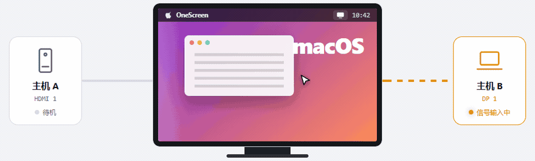

<div align="center">


# OneScreen

**单显示器多机极简物理切屏工具**

一块显示器，两台主机。双击托盘即切设备；配合 [Oink](https://github.com/oinkvm/oink) 实现鼠标划过屏幕边缘瞬间自动切屏。  
零额外线缆，无物理 KVM 盒子中转，保留原生高刷、HDR 与无损画质。

[](https://github.com/iroha3/onescreen/releases/latest)
[]()
[](LICENSE)

[快速开始](#快速开始) · [技术原理](#技术原理) · [常见问题](#常见问题) · [产品主页 (Web)](https://iroha3.github.io/onescreen/)

<br>



</div>

---

## 典型应用场景

> **「我有一台 Windows 台式机和一台 Mac 笔记本，但桌上只有一块显示器。」**

* **传统痛点**：
  * **按键抠破皮**：每次切设备都得把手伸到显示器背面抠繁琐的 OSD 实体按键。
  * **物理 KVM 昂贵且损画质**：市售支持 4K 144Hz / 2K 240Hz / HDR 的物理 KVM 盒子价格高昂，且线缆杂乱、信号中转存在黑屏闪烁风险。
  * **无线投屏 / 虚拟副屏延迟大**：网络串流受带宽限制，画面压缩模糊，无法用于重度办公与游戏。
* **OneScreen 解法**：
  * 两台主机分别直连显示器的不同物理接口（如 Windows 接 DP 1，Mac 接 HDMI 2 或 Type-C）。
  * 纯软件通过 DDC/CI 协议直控显示器内部芯片换源。
  * 搭配 **Oink**，键鼠滑过屏幕边缘瞬间自动切过去，用起来就像一块连续操作的大桌面。

---

## 方案对比

| 方案 | 硬件成本 | 布线复杂度 | 切换方式 | 信号链路与画质 |
| :--- | :--- | :--- | :--- | :--- |
| **物理 KVM 切换器** | 较高（几百至上千元） | 线缆成倍增加 | 实体按键或线控 | 信号经过芯片中转，高刷/HDR 兼容性受限 |
| **显示器 OSD 按键** | 无 | 无 | 繁琐难按 | 主机直连，实体按键易损耗 |
| **网络虚拟副屏/串流** | 无 | 无 | 窗口拖拽 | 网络压缩有损，高延迟，依赖主机显卡编码 |
| **OneScreen** | **开源免费** | **无额外线缆** | **托盘双击 / 鼠标划过边缘自动切** | **主机直接输出，原生满血高刷无损** |

---

## 核心特性

- **鼠标穿越，信源同行**：联动 [Oink](https://github.com/oinkvm/oink) 自动切屏。鼠标跨过屏幕边缘时，显示器输入源同步物理切换，键鼠与画面丝滑伴随。
- **支持单机部署**：依托 Oink 的双向事件广播机制，通常只需在其中一台常驻主机运行，即可完整处理双向往返切屏。
- **防抖与芯片冷却**：内置 400ms 边缘停顿缓冲与 1000ms 操作冷却间隔，过滤误触并杜绝频繁下发指令冲击显示器控制芯片。
- **全局强制切回热键**：提供全局快捷键 `Ctrl + Alt + Shift + S`（macOS 上为 `Cmd + Option + Shift + S`），在对端休眠、死机或黑屏无信号时，可盲按强制切回本机。
- **配置跨机自适应**：双机部署时可直接共用同一份配置文件，程序根据本机 Hostname 自动智能对调「本机接口」与「对端接口」。
- **轻量零侵入**：单文件免安装，运行内存占用小于 10MB。仅调用操作系统原生显示总线接口（Win32 DXVA2 / m1ddc / ddcutil），无驱动注入，无联网权限要求。

---

## 技术原理

```
┌────────────────────────────────┐       ┌────────────────────────────────┐
│      主机 A (如 Windows)       │       │        主机 B (如 macOS)       │
│  [直连显示器物理端口: DP 1]   │       │ [直连显示器物理端口: HDMI 2]   │
└───────────────┬────────────────┘       └────────────────┬───────────────┘
                │                                         │
        网络广播焦点移出/移入                             │
                │                                         │
                ▼                                         │
┌────────────────────────────────┐                        │
│   Oink (键鼠/剪贴板无缝漫游)   │                        │
└───────────────┬────────────────┘                        │
                │ 触发切屏 Hook                           │
                ▼                                         │
┌────────────────────────────────┐                        │
│           OneScreen            │                        │
└───────────────┬────────────────┘                        │
                │ DDC/CI (VCP Opcode 0x60: 写入目标输入源)│
                ▼                                         ▼
┌─────────────────────────────────────────────────────────────────────────┐
│                           同一台物理显示器                              │
│         [内置 Scaler 芯片通过固态电子开关瞬间选通，直连满血高刷]        │
└─────────────────────────────────────────────────────────────────────────┘
```

---

## 快速开始

### 1. 下载与系统依赖

前往 [Releases 页面](https://github.com/iroha3/onescreen/releases/latest) 获取对应平台的预编译可执行文件：

* **Windows**：
  * 下载 `onescreen-windows-amd64.zip` 或 `.exe`。
  * 解压后直接运行，基于原生 Win32 DXVA2 标准，**无需安装任何额外依赖**。
* **macOS**：
  * 下载 `onescreen-darwin-arm64.tar.gz`（Apple Silicon M1/M2/M3/M4）或 `amd64`（Intel）。
  * 依赖 `m1ddc` 驱动 DDC 通信，终端执行一行命令安装：
    ```bash
    brew install m1ddc
    ```
* **Linux**：
  * 下载 `onescreen-linux-amd64.tar.gz`。
  * 依赖 `ddcutil`，例如 Ubuntu/Debian：
    ```bash
    sudo apt install ddcutil
    sudo modprobe i2c-dev
    ```

### 2. 配置对端接口

1. 启动程序，系统托盘区域将常驻 OneScreen 图标。
2. 右键点击图标，展开 **「另一台接的接口」** 菜单，勾选对端主机插入的显示器物理接口（例如 `HDMI 2` 或 `DP 1`）。
3. 配置将自动持久化保存。若误选端口导致黑屏，使用全局热键或实体按键切回后重新勾选即可。

### 3. 开始切换

* **手动切换**：双击托盘图标，或点击托盘右键菜单顶部的「切换到另一台」。
* **随动切换**：启动 Oink，在托盘菜单中勾选 **「随 Oink 自动切屏」**，将鼠标平移划过屏幕边缘即自动触发。

---

## 常见问题与排查 (Troubleshooting)

### Q: 频繁切换输入源是否会影响显示器寿命？
**不会。**  
现代显示器的信源切换由内置 Scaler 芯片通过固态电子开关切换，内部无继电器等机械活动部件。切换过程中面板背光与主供电保持恒定，无高压启辉冲击。同时，OneScreen 内置了 400ms 边缘缓冲防抖和 1000ms 冷却保护，杜绝短时间内高频往返写入控制芯片。

### Q: 误选了不存在的输入源导致黑屏，或对端死机无信号时，如何切回？
系统具备三重安全兜底：
1. **全局热键盲按兜底**：随时按下全局快捷键 `Ctrl + Alt + Shift + S`（macOS 为 `Cmd + Option + Shift + S`），OneScreen 会立即强制下发回切本机指令；
2. **硬件实体按键兜底**：由于两台主机是物理直连显示器的不同独立接口，即便软件退出或系统挂起，显示器机身的实体 OSD 按钮随时可以手动选择信源；
3. **安全无损**：拔插线缆或重启均不会损坏硬件或配置，在托盘重新选回正确端口即可。

### Q: 为什么双击托盘无反应，显示器没有切换？
请重点排查以下两处链路设置：
1. **显示器未开启 DDC/CI**：部分显示器出厂默认关闭该通道，请进入显示器机身的实体 OSD 菜单（通常在「设置/系统」分类下），确认已启用 **DDC/CI** 功能；
2. **转接头或扩展坞屏蔽了 I²C 引脚**：部分低成本 Type-C 转接线或扩展坞未引出 DDC 通信针脚。请尝试使用原装 DP/HDMI 直连线，或确认扩展坞支持 DDC/CI 协议透传。

### Q: OneScreen 与 Oink 是什么关系？切屏后键鼠如何过去？
两者分工明确、协同工作：
* **Oink** 负责**键鼠输入流转与剪贴板同步**（网络级软件 KVM）；
* **OneScreen** 负责**物理显示器硬件信源切换**（屏幕直控）。  
当鼠标滑至边缘时，Oink 将键鼠控制焦点转移至对端主机，OneScreen 同步驱动显示器物理切换到对端接口，两相结合彻底替代实体物理 KVM 盒子与杂乱线缆。

### Q: 为什么单台设备安装即可运行？什么情况下建议两台都装？
Oink 具备全局广播网络事件机制，鼠标从本机离开或从对端移回均会发出事件通知，因此一台常驻主机即可完整处理双向切屏。  
* **建议双端安装的场景**：当其中一台设备是经常外出的笔记本，或两台设备开关机时间不同步时，建议两台均安装运行，以保证任一设备单独开机时均可自主掌控信源。

---

## 从源码构建 (Build from Source)

需要 Go 1.22 或更高版本：

```bash
# 克隆仓库
git clone https://github.com/iroha3/onescreen.git
cd onescreen

# Windows 构建 (无控制台黑框)
go build -ldflags "-s -w -H windowsgui" -o onescreen.exe .

# macOS 构建
go build -ldflags "-s -w" -o onescreen-darwin .

# Linux 构建
go build -ldflags "-s -w" -o onescreen-linux .
```

---

## 开源协议

本项目基于 [GNU Affero General Public License v3.0 (AGPLv3)](LICENSE) 协议开源。  

特别鸣谢 [Oink](https://github.com/oinkvm/oink) 提供的无缝键鼠跨机漫游能力。

© 2026 [iroha3](https://github.com/iroha3). All rights reserved.
